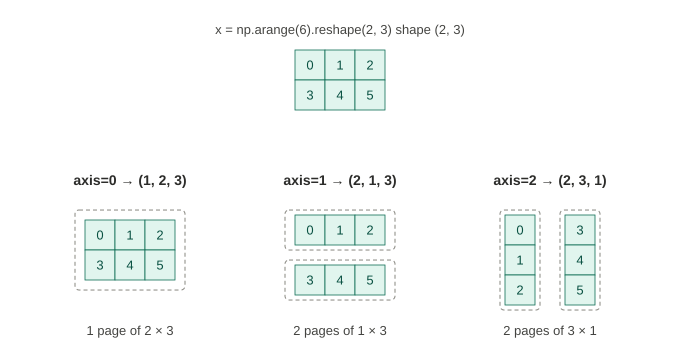
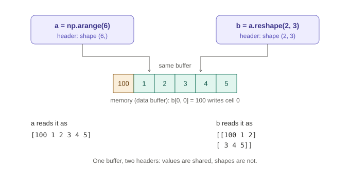

# NumPy Basics: indexing, reshape, new axes and views

- Date: 2026-11-17
- Stage: Stage 0 / Week 1 / Session 1 (blocks 1–2 done, block 3 started)
- Source: *NumPy: the absolute basics for beginners* — "Can you reshape an array?", "How to add a new axis"
- Study time: about 1.5 hours

## 1. One bracket pair = one operation

**Rule:** inside one `[]`, commas separate positions, and position k is axis k. A second `[]` starts again from axis 0.

```
m = [[1 2 3]
     [4 5 6]]          shape (2, 3)

m[1, 2]   one step:  axis0=1, axis1=2          -> 6
m[1][2]   two steps: m[1] -> [4 5 6], then [2] -> 6   (works, but makes a temporary array)

m[:, 1]   one step:  all rows, column 1        -> [2 5]
m[:][1]   two steps: m[:] -> whole m, then [1] -> row 1 -> [4 5 6]   (TRAP)
```

> My mistake: predicted `m[1][2]` does not work. It works because each step returns something indexable.
>
> Habit: for multi-dimensional arrays, always use one `[]` with commas.

## 2. The comma makes the tuple

**Rule:** a tuple is made by commas, not parentheses. So `obj[1, 2]` is `obj[(1, 2)]`.

| Object | Receives `(1, 2)` | Result |
| --- | --- | --- |
| ndarray `m` | "axis 0 → 1, axis 1 → 2" | `6` |
| list `lol` | only accepts int or slice | `TypeError: ... not tuple` |

A list needs two steps: `lol[1][2]`.

> My first summary was "only tuples can read in one step". Correct: the tuple is the **index**. NumPy arrays accept a tuple index; lists do not.

## 3. Small things

- `np.empty((2, 3))` → leftover memory read as `float64`, e.g. `-8.85e-312`. Always assign before reading.
- `>>>` = new statement. `...` = statement not finished (open bracket, or a block after `:`). Do not copy `>>>` / `...` from the docs.

## 4. `reshape`

**Rule:** the product of the new shape must equal `size`.

```
a = np.arange(6)            (6,)
a.reshape(2, 3)    ok       2*3 = 6
a.reshape(4, 2)    Error    4*2 = 8 != 6
a.reshape(6)       ok       one int -> 1-D, shape (6,)
a.reshape(3, -1)   (3, 2)   -1 = "work it out": 6 / 3 = 2
```

- At most one `-1`, and it must divide evenly. `a.reshape(-1)` flattens any array.
- `a.reshape(2, 3)` and `a.reshape((2, 3))` both work; `np.reshape(a, shape=(1, 6))` needs the tuple.
- `order` (optional, default `'C'`): the order in which elements are read and filled.

```
a = [0 1 2 3 4 5]
order='C' (row-major, last index fastest)   order='F' (column-major, first index fastest)
[[0 1 2]                                    [[0 2 4]
 [3 4 5]]                                    [1 3 5]]
```

- **contiguous** = elements sit next to each other in memory with no gaps (like `int x[6]` in C). `a[::2]` is a view with gaps, so it is not contiguous; `.copy()` packs it again. Check with `arr.flags['C_CONTIGUOUS']`.

## 5. Row vector vs column vector

**Rule:** a 1-D array `(n,)` has **no direction**. Add a length-1 axis to make it a row or a column.

| Shape | ndim | Meaning | How |
| --- | --- | --- | --- |
| `(6,)` | 1 | plain 1-D array | `np.array([1,2,3,4,5,6])` |
| `(1, 6)` | 2 | row vector | `a[np.newaxis, :]` |
| `(6, 1)` | 2 | column vector | `a[:, np.newaxis]` (same as `a[:, None]`) |

Why it matters: broadcasting (next session) and gradients (`w` as `(d,)` vs `(d, 1)`, week 3) give different shapes.

## 6. `np.expand_dims`: insert a length-1 axis

**Rule:** `axis=k` inserts a `1` at position `k` of the shape. Data and `size` do not change.

```
shape (2, 3)        slots:  _ 2 _ 3 _
                            0   1   2
axis=0  ->  (1, 2, 3)
axis=1  ->  (2, 1, 3)
axis=2  ->  (2, 3, 1)       axis=-1 is the same as axis=2
axis=3  ->  AxisError: the result has 3 axes, valid positions are 0..2
```

```
x (2,3)        axis=0 (1,2,3)    axis=1 (2,1,3)    axis=2 (2,3,1)
┌─┬─┬─┐        ┌───────┐         ┌───────┐         ┌─┐ ┌─┐
│0│1│2│        │ 0 1 2 │         │ 0 1 2 │         │0│ │3│
├─┼─┼─┤        │ 3 4 5 │         └───────┘         │1│ │4│
│3│4│5│        └───────┘         ┌───────┐         │2│ │5│
└─┴─┴─┘        1 page            │ 3 4 5 │         └─┘ └─┘
                                 └───────┘         2 pages
                                 2 pages
```



**Index view:** `x[i, j]` becomes `y[0, i, j]` / `y[i, 0, j]` / `y[i, j, 0]`. The new index can only be 0.

Mirror of `sum`: `sum(axis=k)` **removes** number k from the shape; `expand_dims(axis=k)` **inserts** a 1 there.

> My mistake: predicted `y[1, 1, 0]` wrong. Correct: page 1, row 1, col 0 → `4`.

## 7. Why a view is a view

**Model:** an ndarray = one block of memory (data buffer) + a header that says how to read it (`shape`, `dtype`, strides).



```
memory:   [100] 1 2 3 4 5
a header: shape (6,)    -> prints [100 1 2 3 4 5]
b header: shape (2, 3)  -> prints [[100 1 2] [3 4 5]]
```

- `reshape`, slicing and `expand_dims` move no elements; they only make a new header → view.
- `a.reshape(2, 3)` does **not** change `a`'s shape; it returns a new view.
- Test: "Can the result be read from the original memory by only changing shape / start / step?" Yes → view. No → copy.

> My mistakes:
> - Predicted `print(a)` shows 2 rows after `b[0, 0] = 100`. Values are shared, shapes are not.
> - Said "it is a view because it is not a copy" (circular). The reason is the header model above.

## 8. Experiment log (predict first, then run)

| # | Code | My prediction | Actual | Note |
| --- | --- | --- | --- | --- |
| 1 | `m[0, 1]` | 2 | `2` | ✓ |
| 2 | `m[1, -1]` | 6 | `6` | ✓ |
| 3 | `m[1][2]` | error | `6` | ✗ two steps, see §1 |
| 4 | `lol[1, 2]` | error | `TypeError: ... not tuple` | ✓ see §2 |
| 5 | `a.base is None` | True | `True` | ✓ |
| 6 | `c.base is None` (`c` is a copy) | True | `True` | ✓ |
| 7 | `np.empty((2, 3))` | 2×3 garbage | garbage `float64` | ✓ |
| – | `m[:]`, `m[:][1]`, `m[:, 1]` | – | whole `m`, `[4 5 6]`, `[2 5]` | trap in §1 |
| – | `t = 1, 2; type(t)`, `m[(1, 2)]`, `lol[(1, 2)]` | – | `tuple`, `6`, `TypeError` | §2 |
| 8 | `a.reshape(2, 3)` | `[[0 1 2] [3 4 5]]` | same | ✓ |
| 9 | `a.reshape(4, 2)` | error | `ValueError: cannot reshape array of size 6 into shape (4,2)` | ✓ |
| 10–12 | `a[np.newaxis, :]`, `a[:, np.newaxis]`, `a[:, None]` | ran doc examples | `(1, 6)`, `(6, 1)`, `(6, 1)` | – |
| 13 | `b = a.reshape(2, 3); b[0, 0] = 100; print(a)` | `[[100 1 2] [3 4 5]]` | `[100 1 2 3 4 5]` | ½ value right, shape wrong, §7 |
| 14 | `a.reshape(3, -1).shape` | ? | `(3, 2)` | new: `-1`, §4 |
| – | `expand_dims(x, axis=0/1/2)` | – | `(1,2,3)`, `(2,1,3)`, `(2,3,1)` | §6 |
| – | `expand_dims(x, axis=3)` | – | `AxisError` | §6 |
| – | `y[1, 1, 0]` | wrong | `4` | ✗ §6 |
| – | `expand_dims(x, axis=-1).shape`, `np.shares_memory(x, y)` | – | `(2, 3, 1)`, `True` | §6, §7 |

## 9. Vocabulary

| Term | Meaning |
| --- | --- |
| specify | give explicitly, pass as an argument (指定) |
| explicitly | done by you on purpose, not automatically (显式地) |
| convert A to B | change A into B (把 A 转换成 B) |
| row / column vector | 2-D array with shape `(1, n)` / `(n, 1)` (行向量 / 列向量) |
| expand / insert | make larger / put in (扩展 / 插入) |
| at a specified position | at the position you give (在指定位置) |
| index order | the order indices are walked (索引顺序) |
| row-major / column-major | C order / Fortran order (行优先 / 列优先) |
| contiguous | stored next to each other, no gaps (连续的) |
| optional | not required (可选的) |
| out of bounds | outside the valid range (越界) |
| continuation prompt | the `...` shown when a statement is unfinished (续行提示符) |

## 10. Self-check (explain out loud)

- [ ] Why does `m[:][1]` give a row, not a column?
- [ ] Why does `lol[1, 2]` raise an error that mentions `tuple`?
- [ ] What must be true for `reshape` to work? What does `-1` do, and when does it fail?
- [ ] What is the difference between shapes `(6,)`, `(1, 6)` and `(6, 1)`?
- [ ] For `x` with shape `(2, 3)`, what is `np.expand_dims(x, axis=1).shape`? Why is `axis=3` an error?
- [ ] After `b = a.reshape(2, 3); b[0, 0] = 100`, what are `a.shape` and `a[0]`? Explain with "buffer + header".

## 11. Next steps

- Run if not done yet (predict first): `a.reshape(7)`; `a.reshape(2, 3, order='C')` vs `order='F'`; `a[::2].flags['C_CONTIGUOUS']` and the `.copy()` version; `a.reshape(-1, 2)`, `a.reshape(-1)`, `a.reshape(4, -1)`, `a.reshape(-1, -1)`
- Block 3: boolean indexing, read "Indexing and slicing", then questions 15–19 (`a < 5`, `a[a < 5]`, `&`, `% 2 == 0`, is a boolean result a view?)
- Block 4: `sum` with `axis` and `keepdims`
- Then the 8 summary prediction questions → Session 1 done
- Habit to keep: write the prediction **before** running (several rows above have no prediction)
